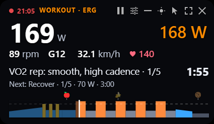
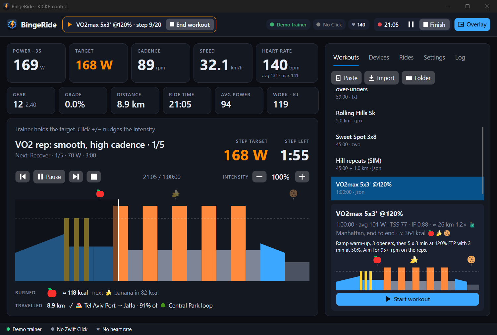

# BingeRide

A small Windows app for riding a smart bike trainer while you watch something. It works over Netflix, any other streaming service, a video player, or any other window on your PC.

**Overlay mode** is the main feature. A small see-through panel stays on top of your video and shows your power, target and workout. See [Overlay mode](#overlay-mode).

BingeRide was built for the **Wahoo KICKR CORE 2 with Zwift Cog**. It can also control other Bluetooth smart trainers. See [Trainers](#trainers).



*Overlay mode. On your screen, the background of the panel is see-through. The picture shows it as black.*



*The main window. Both pictures show a simulated ride with the demo trainer.*

**Modes**
- **ERG:** the trainer holds the target watts.
- **Slope:** a simulated climb, with virtual gears.
- **Free:** a flat road where you just shift.
- **Workout:** structured sessions that mix all three.

**Workout import**
- Files: `.json` (own format), `.zwo`, `.erg`, `.mrc`, `.fit`, intervals.icu text, and `.gpx`/`.tcx` routes.
- Ask Claude for one and it lands in the app.

**Control**
- A **Zwift Click** shifts gears, or nudges watts in ERG.
- **Heart rate** comes from any Bluetooth strap, or a watch broadcasting HR (e.g. a Garmin Forerunner 970). It shows live, with average and max.
- **Food burned 🍕:** ride energy turned into food (kcal ≈ kJ of work). Workouts show 🍎🍌🍪🍕🍔 on the chart where you'll burn each one. Free rides pop up "🍕 Slice of pizza burned!" as you go. Rides list them, the overlay can show them, and *Settings* turns it off.
- **Rides are recorded** in any mode: Start ride, then Finish. Each ride is saved as a `.fit` activity for Strava, Garmin Connect or intervals.icu.

Built with Avalonia 12 on .NET 10, using Bluetooth LE through WinRT. No Zwift account or app is needed.

## Install

BingeRide runs on 64-bit Windows 10 version 2004 or newer, and on Windows 11. Your PC needs Bluetooth LE to connect to a trainer. You do not need admin rights, and you do not need to install .NET.

1. Download [BingeRide-Setup.exe](https://github.com/idog2k/BingeRide/releases/latest/download/BingeRide-Setup.exe).
2. Run the file. If Windows shows "Windows protected your PC", press **More info**, then **Run anyway**. Windows shows this message because the app has no code signature.
3. Follow the steps in the installer. One step lets you add desktop shortcuts.
4. Start **BingeRide** from the Start menu. The **BingeRide Overlay** shortcut starts the app in overlay mode.
5. Follow the [first ride checklist](#first-ride-checklist).

To update BingeRide, close it, then do steps 1 to 3 again. Your rides, workouts and settings stay.

To remove BingeRide, open *Settings → Apps → Installed apps* in Windows, then uninstall it. Your data stays in `Documents\BingeRide`, `%APPDATA%\BingeRide` and `%LOCALAPPDATA%\BingeRide`. To remove your data too, delete these folders.

To use BingeRide without the installer, download `BingeRide.exe` from the [latest release](https://github.com/idog2k/BingeRide/releases/latest). Put the file in any folder and start it. This method adds no shortcuts and no uninstall entry.

## Overlay mode

Overlay mode is the main way to use BingeRide during a ride. The full window hides, and a small see-through panel stays on top of your screen. Your numbers sit over the video, so you do not have to leave it.

BingeRide does not connect to the video app, so it does not matter what you watch. The panel stays on top of other windows, including full-screen video in a browser or a player. An app that takes exclusive control of the screen, such as some full-screen games, can still cover it.

The panel shows:
- The fields you choose, in the order you choose. The defaults are power, target, cadence, gear, speed and heart rate.
- The ride time and the mode.
- In a workout: the step, the time left in the step, the next step, a chart of the workout, and the cues.
- A warning if the trainer is not connected.

| Control | Action |
|---|---|
| **Overlay** button / `Ctrl+Alt+K` | Switch between the full window and the overlay. `Esc` on the overlay also goes back to the full window. |
| `Ctrl+Alt+L` | Turn mouse click-through on or off. When it is on, your clicks go to the video under the panel. |
| Drag the panel | Move it. The app remembers the position. |
| Overlay `−` / ☀ | Make the background more / less transparent. |
| Overlay sliders icon | Choose and order the fields: power, target, cadence, speed, heart rate, gear, grade, distance, ride time, avg power, kJ, avg/max HR, calories, food, famous trip. The first two are big. Also in *Settings*. |
| Overlay ✕ | Quit BingeRide. |

`Ctrl+Alt+K` and `Ctrl+Alt+L` work from any app. Other keys go to the video while it has focus. To change gears or watts without leaving the video, use a Zwift Click or the [iPhone remote](#iphone-remote).

*Settings → Overlay* sets the size and the background opacity. It can also start the app in overlay mode every time. The `--overlay` option does the same for one start.

## Trainers

BingeRide was built for the Wahoo KICKR CORE 2 with Zwift Cog. It can also control other Bluetooth smart trainers.

When BingeRide connects to a trainer, it tries Zwift's protocol first. If the trainer does not answer, BingeRide uses FTMS (Fitness Machine Service, the standard Bluetooth protocol for trainers). The header shows which protocol is in use.

| Header shows | Trainer | Gears |
|---|---|---|
| `· virtual shifting` | A KICKR CORE 2 with Zwift Cog, or another trainer that answers Zwift's protocol | The trainer does the virtual shifting. |
| `· FTMS` | Any other Bluetooth trainer that supports FTMS | The app emulates the gears by changing the simulated grade and resistance. |

All modes, the overlay, the Zwift Click and ride recording work with both protocols.

To use a trainer that is not a KICKR:
1. Pedal so that the trainer wakes up.
2. Open *Devices*, then press **Connect** next to your trainer under *Nearby*. BingeRide connects automatically only to names that start with `KICKR`. After you press **Connect**, it remembers your trainer and connects to it at each start.
3. If the header shows `· FTMS`, open *Settings → Trainer (advanced)*. Set *Chainring* and *Cog* to the gear that your chain is in. The emulated gears use this ratio.

Limits:
- BingeRide uses Bluetooth only. A trainer that does not offer FTMS over Bluetooth, for example one with only ANT+, does not appear under *Nearby*.
- Trainers other than the KICKR are not tested on real hardware. If one does not work, read the Bluetooth trace in `%LOCALAPPDATA%\BingeRide\logs\ble-*.log`.

## Run it

The installer puts `BingeRide.exe` in `%LOCALAPPDATA%\Programs\BingeRide`. To build the file from source and copy it to that folder, run `scripts/publish-windows.sh` in WSL.

BingeRide used to be called **MyWahoo**. On its first start it renames the old `MyWahoo` folders in Documents, `%APPDATA%` and `%LOCALAPPDATA%`, so rides, workouts, settings and paired phones carry over. Close the old MyWahoo first.

| Option | What it does |
|---|---|
| `--overlay` | Start in the compact overlay. |
| `--no-bluetooth` | UI only; use *Devices → Demo trainer* to try it out. |

### First ride checklist

1. Update the trainer firmware with the app from its maker. On a KICKR CORE 2, use the Wahoo app. Virtual shifting needs 2.2.44 / 3.2.44 or newer.
2. **Close Zwift, the Wahoo app and anything else using the trainer or the Click.** Each device obeys one app at a time.
3. Start BingeRide and pedal so the trainer wakes up.
   - A KICKR connects automatically. For any other trainer, press **Connect** in *Devices* the first time. See [Trainers](#trainers).
   - The header shows `KICKR CORE … · virtual shifting`, or `· FTMS` if the trainer refused Zwift's protocol.
   - Press any Click button so it advertises.
   - On the Garmin, hold **LIGHT** → **Broadcast Heart Rate**. Or enable *Broadcast During Activity* and start an Indoor Bike activity. The app connects to the first heart-rate sensor it sees and remembers it; *Devices → Connect* switches to another one.
4. In **Free**, shift through a few gears and check that the resistance changes. Then try **ERG** at 120 W.
5. Start your video and press `Ctrl+Alt+K` to switch to the overlay.
6. If something misbehaves, the Bluetooth trace is in `%LOCALAPPDATA%\BingeRide\logs\ble-*.log`, with every byte sent and received. *Settings → Trainer (advanced)* can force FTMS or send ERG over FTMS.

## Riding

**Device chips (top right):** green means connected, orange means connecting (or the Click v2 "−" puck is locked), grey means not found. Hover a chip for details. The *Devices* tab marks connected devices **✓ Connected**.

**Recording a ride**
- Press **Start ride**, the red button, or Space.
- Time, distance, kJ, power and heart-rate totals only count while recording. They pause on **❚❚** and auto-pause when you stop pedalling.
- **Finish** saves the ride to `Documents\BingeRide\Rides` as a `.fit` file plus a summary, listed in the *Rides* tab. Upload the file at strava.com/upload, in Garmin Connect (Import data) or at intervals.icu.
- Starting a workout starts recording automatically.

**Workouts** start from the *Workouts* panel (or "Start now" when Claude delivers one). While a workout runs, it drives the trainer: the ERG / Slope / Free switch is replaced by a banner with the workout's name and step, and **End workout** returns you to your previous mode. The ride keeps recording.
- Closing the app saves an unfinished ride. Rides under a minute are discarded.
- If your Garmin also records the session, for example with *Broadcast During Activity*, you get two activities. Keep one.

| Control | Action |
|---|---|
| Click `+` / `−` (and **B** = down) | Gears in Slope/Free and in slope/free workout steps; watts in ERG; intensity ±2 % in ERG workout steps |
| Keyboard `+`/`−`/↑/↓, Space | Same, plus start / pause / resume the ride |

The overlay controls are in [Overlay mode](#overlay-mode).

**Zwift Click v2.** The "−" puck stops sending presses about a minute after connecting, unless the Zwift app has unlocked it in the last ~24 h. This is Zwift's lock, and no third-party app can undo it. That is why **B** on the "+" puck also shifts down. *Settings* has an option to keep rebooting the "−" puck instead, which leaves 2–3 s gaps.

Workouts pause automatically when you stop pedalling. Button mappings, FTP and steps are in *Settings*, saved to `%APPDATA%\BingeRide\settings.json`.

## iPhone remote

The PC app keeps talking Bluetooth to the trainer. Your phone becomes a live dashboard and remote over home Wi-Fi: power, heart rate, food, workout step and time left, plus gears/watts ±, modes, start, pause and finish a ride, starting workouts, and ride history.

**Pairing (one time)**
1. *Devices → 📱 Pair a phone*. The first time, Windows Firewall asks: allow BingeRide on **private** networks.
2. Scan the QR with the iPhone Camera, then tap the link.
3. In Safari: Share → **Add to Home Screen**.

**Security**
- The QR holds a one-time code that expires after 5 minutes.
- Pairing gives the phone its own random key, an HttpOnly cookie. The app stores only its hash.
- Anything else on your network gets "Not paired". *Devices → Forget* removes a phone, and *Turn off* stops the web server.
- Traffic is plain HTTP inside your home network, like most smart-home gear.

The page keeps the phone awake after your first tap.

## Workouts from Claude

The app watches `Documents\BingeRide\Workouts`. A file that appears there shows up as **"New workout: … Start now"**.

**Claude Code (this machine):**
- Run `scripts/install-skill.sh` once.
- Then just ask, e.g. *"give me a 60 minute VO2 workout, my FTP is 140"*. Claude writes the JSON, checks it with `skills/bingeride-workout/scripts/check_workout.py`, and delivers it into the folder.

**claude.ai:**
- Upload `dist/bingeride-workout.zip` (built by `scripts/install-skill.sh --zip`) under Settings → Capabilities → Skills.
- Or paste the contents of `skills/bingeride-workout/SKILL.md` into a Project's instructions.
- Copy Claude's answer and press **Paste** (or Ctrl+V) in the app. It finds the workout inside the text.

**Other files:** use **Import**, drag them onto the window, or drop them into the folder. The format is documented in [`docs/workout-format.md`](docs/workout-format.md).

## Layout

```
src/BingeRide.Core       protocols (Zwift trainer, FTMS, Zwift Click), devices, ride controller, workout player
src/BingeRide.Workouts   importers: json, zwo, erg/mrc, intervals.icu, fit, gpx/tcx, paste extraction, stats
src/BingeRide.App        Avalonia UI: main window, overlay, workout chart (platform-neutral)
src/BingeRide.Windows    WinRT Bluetooth, click-through/topmost/hotkeys, exe entry point
tests/                 xunit; App.Tests renders the UI headlessly into ./screenshots
installer/             Inno Setup script for BingeRide-Setup.exe
tools/IconGen          regenerates the icons: dotnet run --project tools/IconGen -- src/BingeRide.App/Assets src/BingeRide.App/Web
skills/                the Claude skill
docs/                  workout format, protocol notes and sources
```

Run `dotnet test` from WSL to run everything. Plain Linux works too; only the Windows head needs `EnableWindowsTargeting`.

To publish a release, push a version tag: `git tag v0.1.0 && git push origin v0.1.0`. The workflow in `.github/workflows/release.yml` runs the tests, builds `BingeRide.exe` and `BingeRide-Setup.exe`, and attaches both files to a new GitHub release.

To build only the installer, run `scripts/publish-windows.sh` in WSL. Then, in Windows PowerShell, go to the repository folder and run `powershell -ExecutionPolicy Bypass -File scripts\build-installer.ps1 -Version 0.1.0`. The script downloads Inno Setup from NuGet and writes `dist\BingeRide-Setup.exe`.

## License

MIT; see [`LICENSE`](LICENSE). Bundled third-party components and their licenses are listed in [`THIRD-PARTY-NOTICES.md`](THIRD-PARTY-NOTICES.md). The Garmin FIT SDK has its own license, not MIT.

Not affiliated with, endorsed by, or sponsored by Wahoo Fitness, Zwift, Garmin or Netflix. Their names are trademarks of their owners and are used only to describe compatibility.

Exercise at your own risk: this app controls the resistance of a trainer you ride. If in doubt about your health, check with a doctor before training hard.
